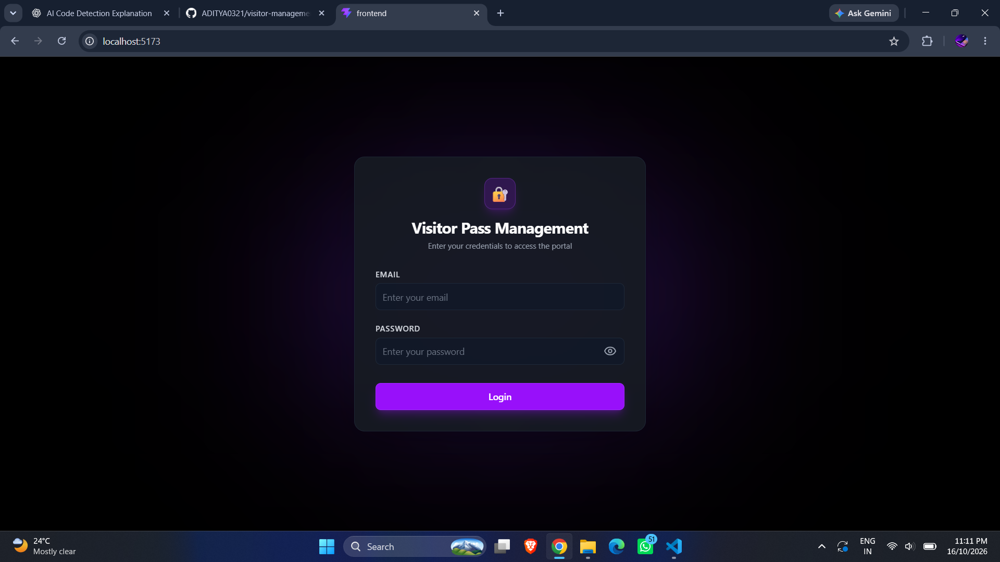
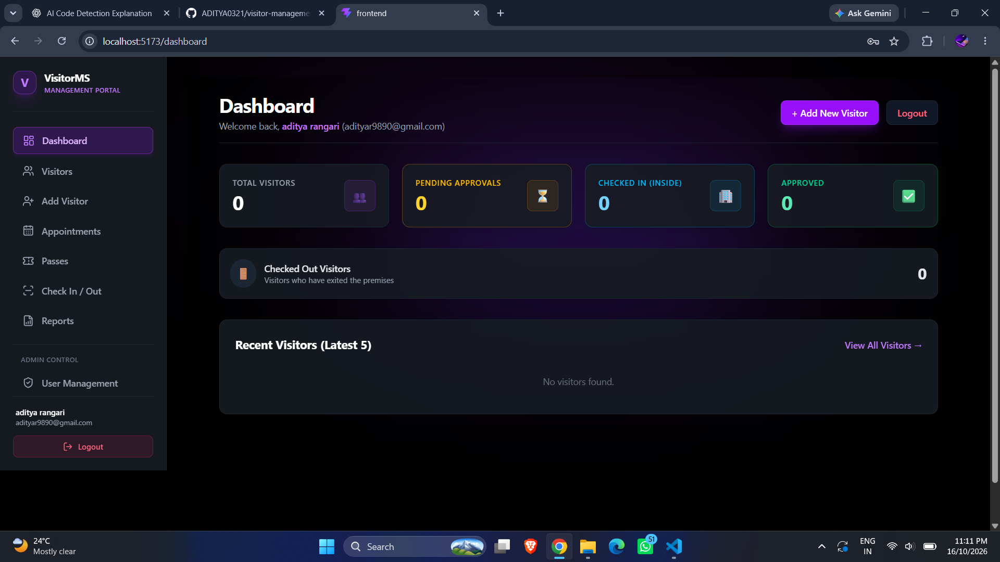
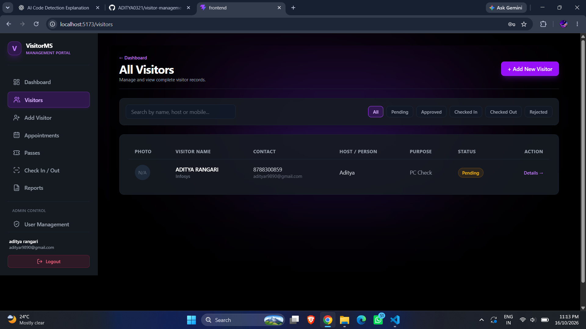
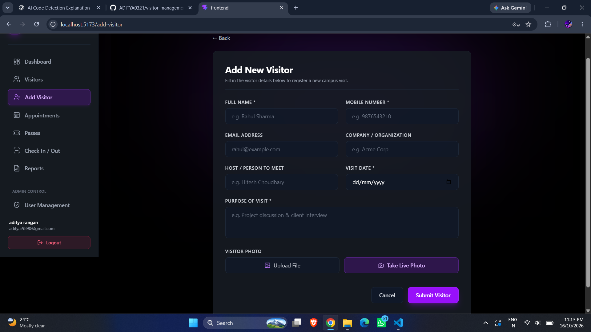
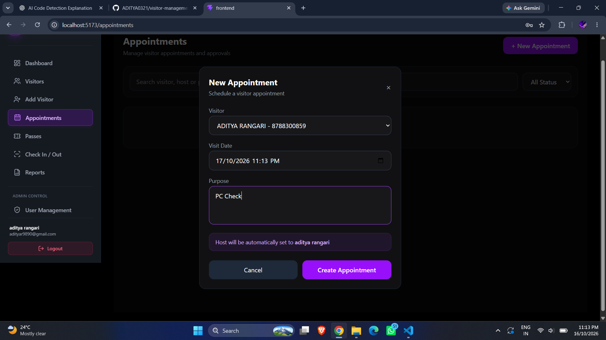
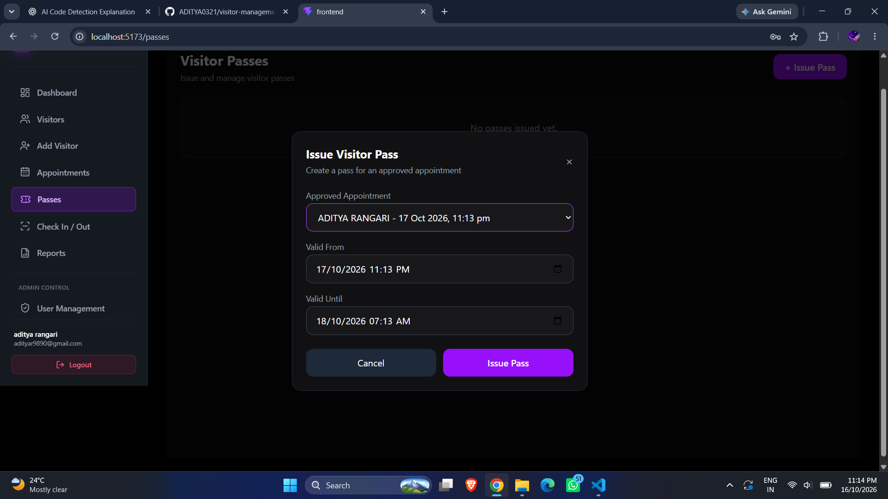
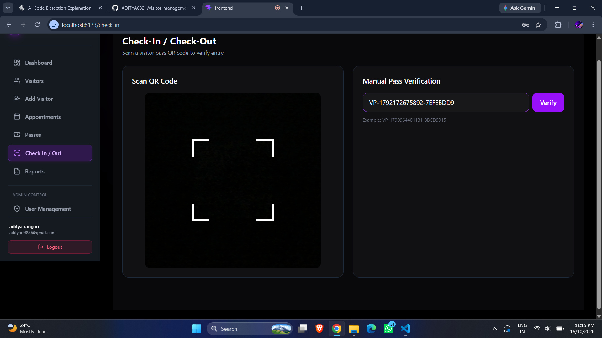
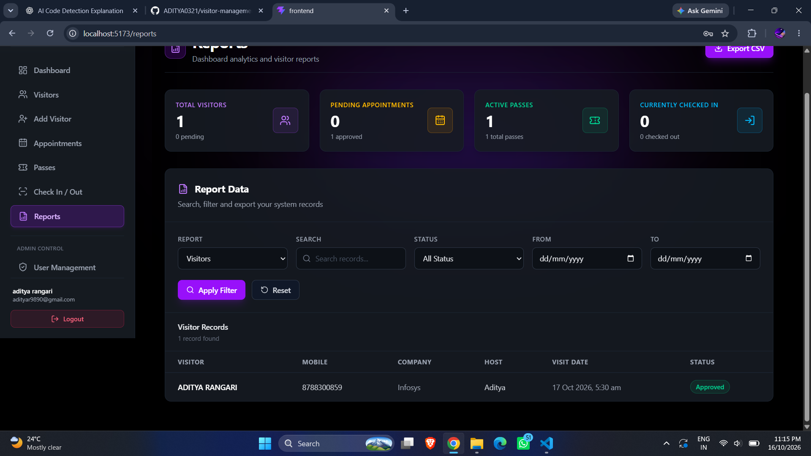
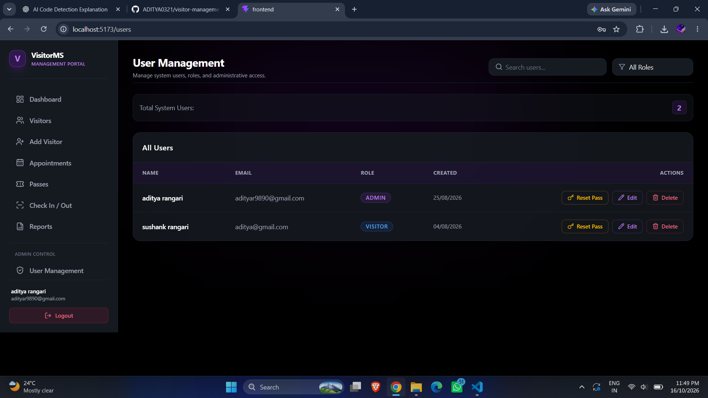

# Visitor Management System

A modern MERN stack Visitor Management System with a dark-themed UI, visitor registration, appointment approvals, QR-based visitor passes, and role-based access control.

## Features

- **Authentication & Authorization** — JWT-based login and role-based access.
- **Visitor Management** — Register, view, update, and manage visitor records.
- **Visitor Photo Capture** — Capture visitor photos using a webcam.
- **Appointment Management** — Manage appointments and approve or reject requests.
- **QR Code Passes** — Generate visitor passes with QR codes and download pass PDFs.
- **Check-In / Check-Out** — Record visitor entry and exit using QR-based verification.
- **Email Notifications** — Send email updates for relevant visitor and appointment activities.
- **Dashboard & Reports** — View system statistics, filter reports, and export data to CSV.
- **User Management** — Manage system users according to their roles.
- **Responsive UI** — Modern interface with a dark theme.

## Tech Stack

**Frontend**
- React.js
- Vite
- JavaScript
- CSS

**Backend**
- Node.js
- Express.js
- MongoDB
- Mongoose
- JWT Authentication

## Screenshots

### Login


### Dashboard


### Visitor Management


### Add Visitor


### Appointments


### Visitor Passes


### Check-In / Check-Out


### Reports


### User Management


## Project Structure

```text
visitor-management-system/
├── backend/
│   ├── controllers/
│   ├── middleware/
│   ├── models/
│   ├── routes/
│   ├── services/
│   ├── package.json
│   └── server.js
├── frontend/
│   ├── src/
│   │   ├── pages/
│   │   ├── routes/
│   │   ├── App.jsx
│   │   └── main.jsx
│   └── package.json
├── screenshots/
├── .gitignore
└── README.md
```

## Getting Started

### Prerequisites

- Node.js and npm
- MongoDB database
- Git

### 1. Clone the Repository

```bash
git clone https://github.com/ADITYA0321/visitor-management-system.git
cd visitor-management-system
```

### 2. Set Up the Backend

```bash
cd backend
npm install
```

Create a `.env` file inside the `backend` directory and configure the environment variables required by your backend, including the MongoDB connection string and JWT secret.

Example:

```env
PORT=4000
MONGO_URI=your_mongodb_connection_string
JWT_SECRET=your_jwt_secret
```

Configure any additional variables required by your application, including email settings if email notifications are enabled.

Start the backend using the script defined in `backend/package.json`.

### 3. Set Up the Frontend

Open a new terminal:

```bash
cd frontend
npm install
npm run dev
```

Open the local URL shown in the terminal.

## Authentication

The application uses JWT-based authentication and role-based access control. User accounts are managed through the application's authorized user-management workflow.

## Security Notes

- Never commit `.env` files, database credentials, JWT secrets, or email app passwords.
- Use strong secrets and configure environment variables in your deployment platform.
- Visitor photos and other private visitor data should be stored securely.

## Future Improvements

- Cloud storage for visitor photos.
- Automated deployment and production monitoring.
- Additional analytics and reporting features.

## Author

**Aditya Rangari**

GitHub: [ADITYA0321](https://github.com/ADITYA0321)

## License

This project is developed for learning and demonstration purposes.
